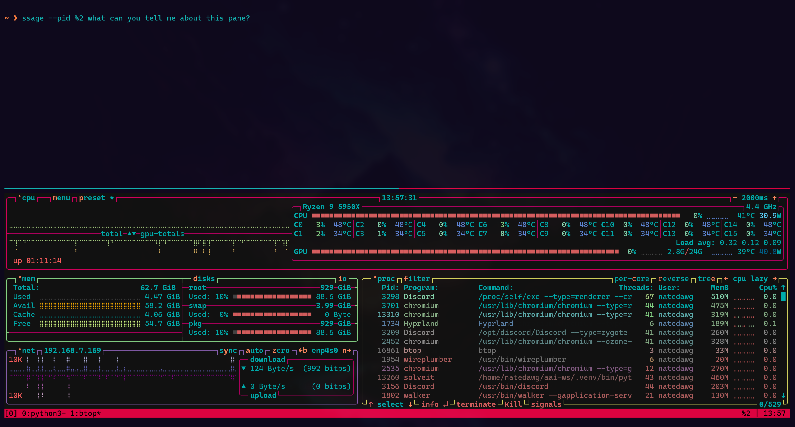

# ShellSage


<!-- WARNING: THIS FILE WAS AUTOGENERATED! DO NOT EDIT! -->

ShellSage is an AI-powered command-line assistant that integrates seamlessly with your terminal workflow through tmux. It provides contextual help for shell operations, making it easier to navigate complex command-line tasks, debug scripts, and manage your system.

[](https://badge.fury.io/py/shell-sage)
[](https://www.python.org/downloads/)
[](https://opensource.org/licenses/MIT)
[](https://answerdotai.github.io/shell_sage/)

## Overview

ShellSage is an AI-powered command-line assistant that integrates seamlessly with your terminal workflow through tmux. It provides contextual help for shell operations, making it easier to navigate complex command-line tasks, debug scripts, and manage your system.

ShellSage works with multiple LLM providers including Claude, GPT, and Ollama. It uses tmux to automatically read your terminal history or multiple pane histories to provide contextual assistance. You can pipe command output or file contents directly to ShellSage, and it can view files, search code, create files, and make edits with your permission. When needed, it can even search the internet for up-to-date information. You can also log all your interactions directly to SQLite for later reference.

## Installation

Install ShellSage directly from PyPI using pip:

``` sh
pip install shell-sage
```

## Installing with `uv`

If you have `uv` installed then you can use its powerful `tool` feature to install ShellSage as a global CLI — safely, with per-tool isolation and no need for manual virtualenv management.

``` sh
uv tool install shell_sage
```

This will make the `ssage` CLI available everywhere on your system.

If you also want to install additional dependencies (for example `fastlite`), you can do it at install time:

``` sh
uv tool install --with fastlite shell_sage
```

### Upgrade

To upgrade ShellSage to the latest version:

``` sh
uv tool upgrade shell_sage
```

### List All Installed Tools

See everything you’ve installed via `uv tool`:

``` sh
uv tool list
```

### Uninstall

To completely remove ShellSage and its environment:

``` sh
uv tool uninstall shell_sage
```

Using `uv tool` keeps ShellSage completely isolated from your project dependencies, so you can safely use `ssage` even when inside another virtual environment.

## Prerequisites

ShellSage defaults to Anthropic’s current Haiku model (`fastllm.types.haik`). Export your Anthropic API key:

``` sh
export ANTHROPIC_API_KEY=sk...
```

If you prefer to use OpenAI instead, export your OpenAI API key and set the model in your ShellSage config or on the command line:

``` sh
export OPENAI_API_KEY=sk...
```

ShellSage works best with a properly configured tmux environment. I’ve created a preconfigured [tmux configuration](tmux.conf) that works well with ShellSage. This configuration enables mouse support, adds pane IDs to your status bar so you can quickly reference them when having ShellSage read from specific panes, turns off alternative-screen so editor content like vim stays in the tmux buffer where ShellSage can see it, and adds a convenient shortcut (CTRL+B+E followed by the index number) for automatically extracting code fence blocks into your command prompt.

## Getting Started

### Your First Command

Once installed, try ShellSage with a simple greeting:

``` sh
ssage hi
```

If everything is properly setup, you should see a welcoming greeting back from ShellSage!

### Getting Help with Commands

The most basic use case is asking about shell commands:

``` sh
ssage "how do I list all files including hidden ones?"
```

ShellSage will provide the command, explain how it works, and give you practical examples.

### Using Terminal Context

ShellSage automatically reads your tmux history to understand what you’re working on:

``` sh
# After running some commands that produced errors (e.g. find -name "*.tmp" .)
ssage "what went wrong with my last command?"
```

### Clearing Context

Ctrl-L looks like it clears the terminal, but it only wipes the visible screen – tmux’s history still holds everything, so ShellSage keeps seeing it. The [`ssage_clear`](https://github.com/AnswerDotAI/shell_sage/blob/main/ssage_clear.sh) binding gives ctrl-L real “clear” semantics for ShellSage without destroying anything: it scrolls the screen into history and records a mark, and ShellSage captures never reach past the most recent clear, while your own scrollback stays intact.

Save the script from the link above, then add to your `.bashrc`:

``` sh
source /path/to/ssage_clear.sh
bind -x '"\C-l": ssage_clear'
```

Or to your `.zshrc`:

``` sh
source /path/to/ssage_clear.sh
zle -N ssage_clear && bindkey '^L' ssage_clear
```

The binding is only active at the shell prompt, so full-screen apps still receive a plain ctrl-L, and outside tmux it falls back to a normal clear.

### Piping Content for Analysis

One of ShellSage’s most powerful features is analyzing piped input. Piped content and terminal history are sent as literal user text, including any embedded tool or usage markers:

``` sh
# Understand error messages
journalctl --since "1 hour ago" --no-pager | ssage explain this error
```

### Working with Multiple Tmux Panes

When you have multiple panes open, you can reference specific ones by their ID (shown in your status bar):



``` sh
# Analyze what's happening in pane %2
ssage --pid %2 "what can you tell me about this pane?"
```

## Configuration and Model Providers

### Configuration File

ShellSage can be customized through a configuration file located at `~/.config/shell_sage/shell_sage.conf`:

    [DEFAULT]
    # model = anthropic/claude-sonnet-5-5     # Optional model override
    search = ''                             # Web search effort for supported models: l, m, or h
    think = ''                              # Reasoning effort for supported models: l, m, or h
    trust = ''                              # Comma-delimited list of tools to always allow
    mode = 'default'                        # or "sassy"
    api_name =                              # API format override: openai for Responses, openai_chat for Chat Completions
    base_url = ''                           # Alternative API base URL
    api_key = ''                            # API key override instead of the default env var
    history_lines = -1                      # Lines of terminal history to include. -1 means include all
    code_theme = "monokai"                  # Syntax highlighting theme
    code_lexer = "python"                   # Default lexer for inline code blocks
    log = False                             # Enable SQLite logging (required for code extraction)
    safecmd = False                         # Enable the safecmd-backed bash tool
    custom_instructions = ''                # Extra instructions appended to the system prompt

Config values expand `$VAR` and `${VAR}` when read. For example, `api_key = ${MY_API_KEY}` reads the current environment value while keeping the reference in the file.

### Using Different Model Providers

ShellSage uses [fastllm](https://github.com/AnswerDotAI/fastllm) under the hood. fastllm can automatically resolve common Claude, Gemini, GPT, and OpenAI model names. For other providers, prefix the model name with the vendor, e.g. `openrouter/openai/gpt-5`:

| Prefix         | API key source                             |
|----------------|--------------------------------------------|
| `openai`       | `OPENAI_API_KEY`                           |
| `anthropic`    | `ANTHROPIC_API_KEY`                        |
| `gemini`       | `GEMINI_API_KEY`                           |
| `openai_chat`  | `OPENAI_API_KEY`                           |
| `codex`        | `CODEX_AUTH_TOKEN` or `~/.codex/auth.json` |
| `claude_code`  | Claude Code subscription (no key needed)   |
| `moonshot`     | `MOONSHOT_API_KEY`                         |
| `deepseek`     | `DEEPSEEK_API_KEY`                         |
| `openrouter`   | `OPENROUTER_API_KEY`                       |
| `together`     | `TOGETHER_API_KEY`                         |
| `fireworks_ai` | `FIREWORKS_API_KEY`                        |
| `qwen`         | `QWEN_API_KEY`                             |

#### Claude, OpenAI, and Gemini

Common Claude, GPT, and Gemini model names are auto-resolved:

``` bash
ssage --model claude-sonnet-4-6 explain systemd timers
ssage --model gpt-5 explain kubernetes pods
ssage --model gemini-2.5-pro what is journald?
```

#### Vendor Prefixes

Prefix the model with a vendor when the name does not identify the provider on its own:

``` bash
ssage --model openrouter/openai/gpt-5 explain cgroups
ssage --model codex/gpt-5.5 review my shell script
```

A `claude_code/` prefix uses your Claude Code subscription instead of an API key:

``` bash
ssage --model claude_code/claude-sonnet-4-6 explain iptables
```

You can also set a prefixed model in your config:

    model = 'codex/gpt-5.5'

#### Other Providers

For another OpenAI-compatible API, provide the API base URL, API key, and model:

``` bash
ssage --base-url https://your-api.com/v1 --api-key your_key --model your_model your query
```

For a Responses-compatible server, pass `--api-name openai`. A custom URL otherwise uses Chat Completions.

For known providers, prefer the matching prefix from the table above so fastllm can use the right API format and environment variable.

### Command Line Overrides

Any configuration option can be temporarily overridden via command line arguments:

``` sh
# Adjust history lines
ssage --history-lines 100 what commands did I just run?

# Change the display theme
ssage --code-theme dracula --code-lexer python show me a python example
```

You can find all available code themes and lexers at https://pygments.org/styles/

### Bash Tool (Safe Command Execution)

ShellSage can execute shell commands on your behalf using the [safecmd](https://github.com/AnswerDotAI/safecmd) library, which provides a safety layer via an allow-list approach.

#### Enabling the Bash Tool

Add to your config file (`~/.config/shell_sage/shell_sage.conf`):

    safecmd = true

#### How It Works

When enabled, ShellSage gains access to a `bash` tool that:

- Validates commands against a curated allow-list before execution
- Supports pipes, redirects, and shell operators
- Blocks potentially destructive operations by default
- Can be customized to allow or restrict allowed commands/destinations

#### Example Usage

``` sh
ssage "what files are in this directory and how big are they?"
# ShellSage can now run `ls -la` or `du -sh *` to answer
```

> See the [safecmd documentation](https://github.com/AnswerDotAI/safecmd) for details on the allow-list

### Extracting and Running Commands

When ShellSage suggests commands, you can extract them directly to your command line. Note that this feature requires you to have logging enabled in your configuration file:

``` sh
ssage "how do I find large files?"
```

ShellSage will respond with code blocks. Press `Ctrl+B E` then enter the index number (0 for first block, 1 for second, etc.) to send that command directly to your prompt. You can also directly use the console script:

``` sh
ssage_extract 0
# inserts "du -ah . | sort -rh | head -20" into your tmux prompt
```

You can also bind a keyboard shortcut in Bash to insert code fences directly into your prompt. Type a block number (or leave empty for 0), then press `Ctrl+J` to insert that code block. To use this, add the following to your `~/.bashrc`:

``` bash
ssage-insert() {
  local r=$(ssage_extract --do-print "${READLINE_LINE:-0}")
  READLINE_LINE="$r" READLINE_POINT=${#r}
}
bind -x '"\C-j": ssage-insert'
```

### Enabling Sassy Mode

For a more entertaining experience, try sassy mode (GLaDOS-inspired):

``` sh
ssage --mode sassy explain git rebase
```

## Contributing

ShellSage is built using [nbdev](https://nbdev.fast.ai/). For detailed contribution guidelines, please see our [CONTRIBUTING.md](CONTRIBUTING.md) file.

We welcome contributions of all kinds:

- Bug reports
- Feature requests
- Documentation improvements
- Code contributions

Please visit our [GitHub repository](https://github.com/AnswerDotAI/shell_sage) to get started.
